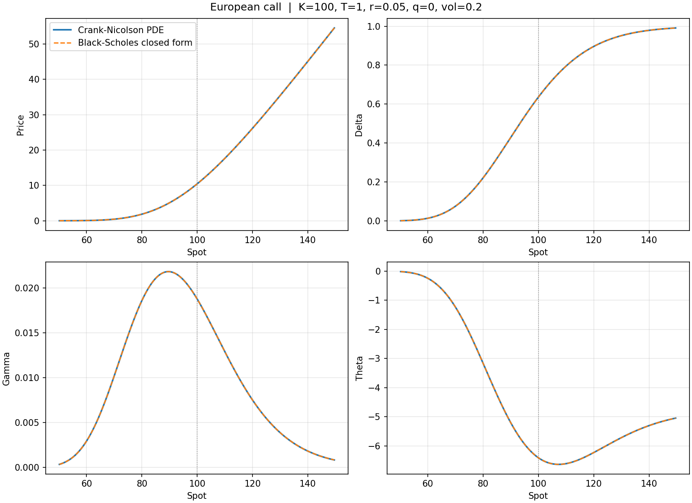
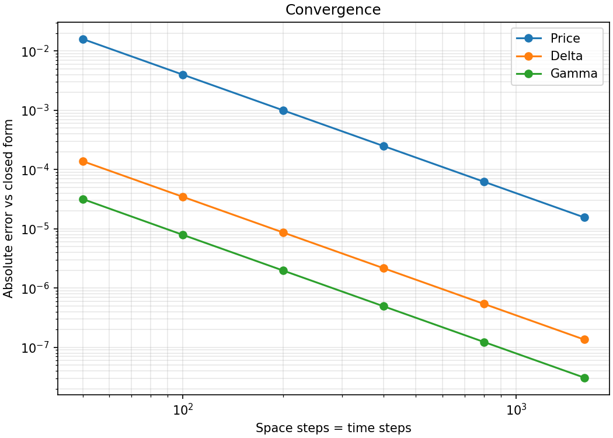

# PDE Option Pricer

A finite-difference pricer for European options under Black-Scholes, built in Python with NumPy, SciPy and Matplotlib.

- Crank-Nicolson scheme on the Black-Scholes PDE in log-price
- Rannacher startup (implicit Euler half-steps) to damp oscillations from the payoff kink
- Non-uniform grid concentrated around the strike
- Delta, gamma and theta computed directly from the grid
- Closed-form Black-Scholes reference for validation, plus tests and plots



## Setup

You need Python 3.10 or newer and Git.

### 1. Get the code

```bash
git clone https://github.com/tudosevlad1234/pde-option-pricer.git
cd pde-option-pricer
```

### 2. Create a virtual environment

macOS / Linux:

```bash
python3 -m venv .venv
source .venv/bin/activate
```

Windows (PowerShell):

```powershell
python -m venv .venv
.venv\Scripts\Activate.ps1
```

### 3. Install

```bash
pip install -e ".[dev]"
```

This installs the package in editable mode together with NumPy, SciPy, Matplotlib and pytest. If you only want to run the code and not the tests, use `pip install -e .` instead. `pip install -r requirements.txt` installs just the three libraries, but then you will need to run scripts from the project root with `PYTHONPATH=.` set.

### 4. Check that it works

```bash
pytest
```

All 59 tests should pass. They cover:

- **Accuracy:** PDE results against the closed-form Black-Scholes values for calls and puts, with and without a dividend yield
- **Convergence order:** second order in space and in time, measured separately for price and all three Greeks
- **Rannacher startup:** that it removes the gamma oscillations plain Crank-Nicolson produces near the strike
- **Financial consistency:** put-call parity, the discounted-intrinsic lower bound, positive gamma, delta bounded by the carry factor, price monotone in spot, scale invariance
- **Grid and inputs:** grid layout for any size, and rejection of invalid inputs (wrong option type, non-finite or non-positive values, non-integer grid sizes)

## Running the example

```bash
python examples/run_example.py
```

This prices a 1-year at-the-money call, prints a comparison with the closed form, and saves two figures into `figures/`:

- `price_and_greeks.png`: price, delta, gamma and theta against spot, PDE versus closed form
- `convergence.png`: error versus grid size

Typical output:

```
                   PDE     Closed form    Abs. error
price        10.450319       10.450584      2.64e-04
delta         0.636833        0.636831      1.90e-06
gamma         0.018763        0.018762      5.76e-07
theta        -6.414166       -6.414028      1.38e-04
```

Invalid inputs stop with a one-line message, for example `error: vol must be positive`.

Options:

```bash
python examples/run_example.py --type put --strike 110 --maturity 0.5 --vol 0.3 --rate 0.03 --div-yield 0.02
python examples/run_example.py --n-space 800 --n-time 400
python examples/run_example.py --show
```

| Flag | Default | Meaning |
|---|---|---|
| `--spot` | 100 | Current underlying price |
| `--strike` | 100 | Strike |
| `--maturity` | 1.0 | Time to maturity in years |
| `--rate` | 0.05 | Risk-free rate |
| `--vol` | 0.20 | Volatility |
| `--div-yield` | 0.0 | Continuous dividend yield |
| `--type` | call | `call` or `put` |
| `--n-space` | 400 | Number of space intervals |
| `--n-time` | 200 | Number of time steps |
| `--rannacher-steps` | 2 | Initial steps replaced by implicit Euler half-steps |
| `--output-dir` | figures | Where the figures are saved |
| `--show` | off | Open the figures in a window |

## Using it as a library

```python
from pde_option_pricer import OptionSpec, price_option, black_scholes

spec = OptionSpec(spot=100, strike=100, maturity=1.0, rate=0.05, vol=0.2)
result = price_option(spec, n_space=400, n_time=200)

print(result.price, result.delta, result.gamma, result.theta)
print(black_scholes(spec))
```

`price_option` returns a `PricingResult` with the price and Greeks at the requested spot, plus the full arrays over the grid (`spot_grid`, `price_grid`, `delta_grid`, `gamma_grid`, `theta_grid`).

`OptionSpec` validates its inputs when it is created, so a misspelled option type or a non-positive volatility raises a `ValueError` immediately instead of producing a wrong number later.

Theta is returned per year, as the derivative with respect to calendar time (negative for a long option in most cases).

## How it works

With `x = ln S` and `tau = T - t`, the Black-Scholes PDE becomes

```
V_tau = 0.5 * sigma^2 * V_xx + (r - q - 0.5 * sigma^2) * V_x - r * V
```

- **Grid.** The log-price axis is built with a sinh transform so that nodes cluster around ln(K), and the strike is always an exact node. The domain extends 5 standard deviations beyond the spot and strike.
- **Spatial discretization.** Second-order finite differences on the non-uniform grid, assembled into a tridiagonal sparse matrix.
- **Time stepping.** Crank-Nicolson, with the first two steps each replaced by two implicit Euler half-steps (Rannacher startup). The step matrices are built once per step type and the implicit one is LU-factorized once, so each time step costs one sparse product and one triangular solve.
- **Boundaries.** Time-dependent Dirichlet conditions from the asymptotic option value at the edges of the grid.
- **Greeks.** Delta and gamma come from the non-uniform finite-difference stencils applied to the solution, converted from log-price back to spot. Theta follows from the PDE itself. Values at the requested spot use a cubic spline over the grid.

## Results

Error against the closed form for a 1-year ATM call (`K=100, r=5%, vol=20%`), with equal numbers of space and time steps:

| Steps | Price | Delta | Gamma | Theta |
|---|---|---|---|---|
| 100 | 4.0e-03 | 3.5e-05 | 7.9e-06 | 2.0e-03 |
| 200 | 1.0e-03 | 8.7e-06 | 2.0e-06 | 4.9e-04 |
| 400 | 2.5e-04 | 2.2e-06 | 4.9e-07 | 1.2e-04 |
| 800 | 6.2e-05 | 5.4e-07 | 1.2e-07 | 3.0e-05 |
| 1600 | 1.6e-05 | 1.4e-07 | 3.1e-08 | 7.6e-06 |

The error falls by roughly a factor of 4 each time the grid is doubled, which is the expected second-order convergence.

### Convergence order, space and time separately

Refining space and time together can hide a weak dimension, so each is also measured on its own by self-convergence (the ratio of successive differences, which cancels the error from the dimension held fixed). Observed orders for a 1-year call with a 2% dividend yield, taken from the finest refinement pair:

| Refined | Held fixed | Price | Delta | Gamma | Theta |
|---|---|---|---|---|---|
| Space (100 → 800) | 4000 time steps | 2.00 | 2.00 | 2.00 | 2.00 |
| Time (25 → 400), with Rannacher | 3200 space steps | 2.00 | 2.00 | 2.01 | 2.01 |
| Time (25 → 400), without Rannacher | 3200 space steps | 0.90 | 1.37 | −0.34 | −0.34 |

Without the startup, Crank-Nicolson loses its second-order accuracy on the kinked payoff, and gamma and theta stop converging altogether: the negative order means successive refinements drift further apart rather than closer together. The temporal order also stays at 2.00 on a narrow domain where the boundary values dominate, which confirms the time-dependent boundary terms are weighted correctly.

### Why the Rannacher startup matters

Crank-Nicolson does not damp the high-frequency error introduced by the payoff kink, and it shows up as oscillations in gamma. For a 3-month ATM call with 400 space steps and a deliberately coarse 25 time steps:

| | Max gamma error near strike | Turns in the gamma curve near strike |
|---|---|---|
| Plain Crank-Nicolson | 3.1 | 9 |
| With Rannacher startup | 1.6e-05 | 1 (same as exact) |

The effect is largest at short maturities. For a 1-year option at the default settings the difference is negligible.



## Project layout

```
pde_option_pricer/
    spec.py        OptionSpec: the contract and market inputs, validated
    grid.py        strike-concentrated non-uniform log-price grid
    solver.py      Crank-Nicolson solver with Rannacher startup, Greeks
    analytic.py    closed-form Black-Scholes price and Greeks
    plotting.py    solution and convergence plots
    _checks.py     shared input validation
examples/
    run_example.py
tests/
    test_solver.py
figures/
requirements.txt
pyproject.toml
```

## Accuracy notes

The defaults (400 space steps, 200 time steps) are tuned for ordinary parameters and give a relative price error around 2e-5 for a 1-year option at 20% volatility. Two cases deserve a larger grid:

- **Long-dated or very high volatility.** The domain spans five standard deviations, so it widens with `vol * sqrt(T)` and the same number of nodes has to cover far more ground. At `T=30, vol=120%` the relative price error is 4% at the default settings, falling to 0.07% at `--n-space 3200`. Convergence stays second order throughout, so refining fixes it.
- **Deep out-of-the-money options.** Absolute errors stay tiny, but the option value itself is so small that relative accuracy is not meaningful. The solver can return values of order 1e-113 with the wrong sign where the true price is 1e-258. This is roundoff around zero, not oscillation.

The upper and lower boundaries use the exact asymptotic option value as a Dirichlet condition. Since that asymptote is approached but never quite reached at a finite boundary, the solution near the edge of the grid carries a small inconsistency: delta can exceed its theoretical cap by about 1e-6 within a couple of nodes of the boundary. It does not affect the region around the strike, which is where the grid is concentrated and where the plots and the reported values live.

## Limitations

- European calls and puts only (no early exercise, no barriers)
- Constant volatility, rate and dividend yield
- Continuous dividend yield only, no discrete dividends
- Grid boundaries are fixed Dirichlet conditions, so values within a few nodes of the edge are less reliable than those near the strike
